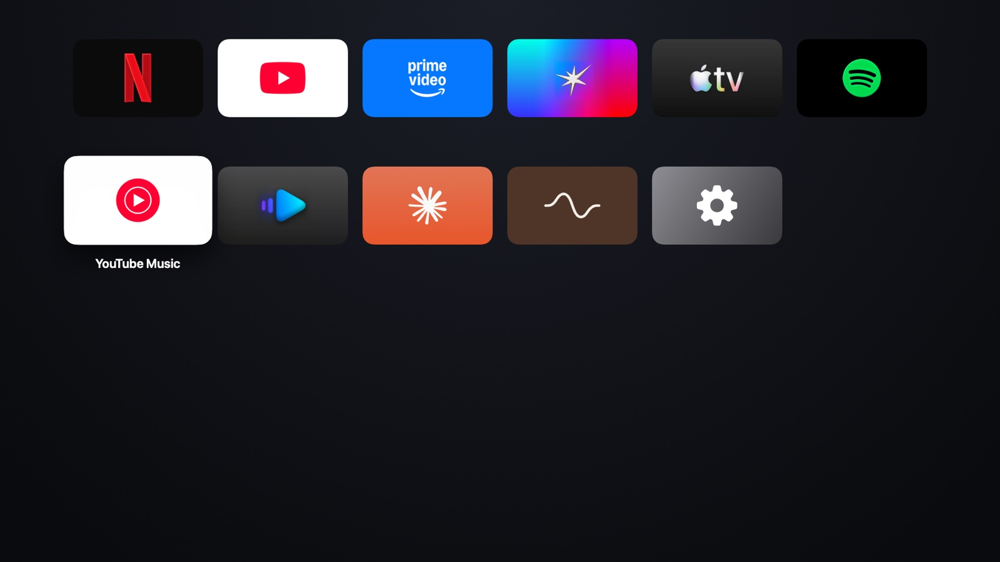
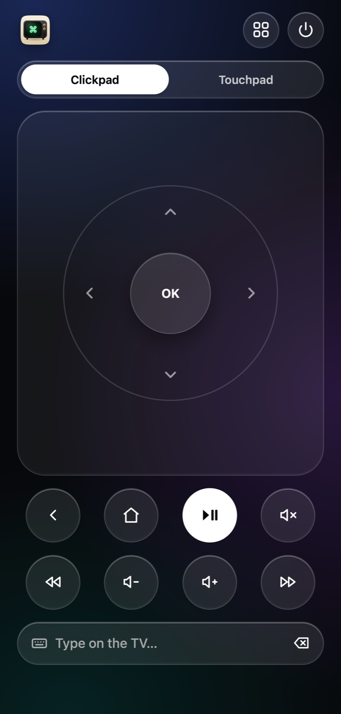

For a long time, I had an idea in the back of my mind: turn a Mac connected to a TV into something I could comfortably use from the sofa. I never quite got around to building it.

Then I came across [Mac TV](https://github.com/Arunprakaash/mac-tv) on Reddit. Arunprakaash had already started building something along those lines, and I thought: heck, why not contribute instead?

<figure>
  
  <figcaption>Mac TV's app grid. Screenshot from the Mac TV project.</figcaption>
</figure>

That turned into a lovely weekend project. I got to work on making it easier to find favourite content, pair a phone as a remote, browse and play local videos, and use a browser from the TV setup. There are still things to improve, of course, but that is part of the fun.

<figure>
  
  <figcaption>The phone remote. Screenshot from the Mac TV project.</figcaption>
</figure>

It was a nice change of pace from my usual work in computational mechanics, and a reminder of what I enjoy about open source: finding something someone else has made, tinkering with it, and helping it grow. Thanks to Arunprakaash for building Mac TV and welcoming my contributions!
